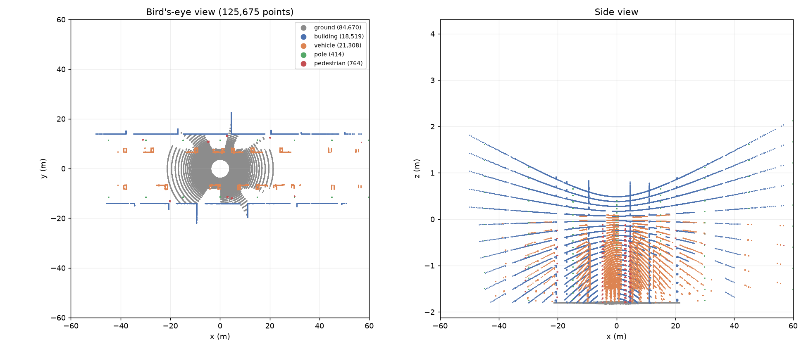
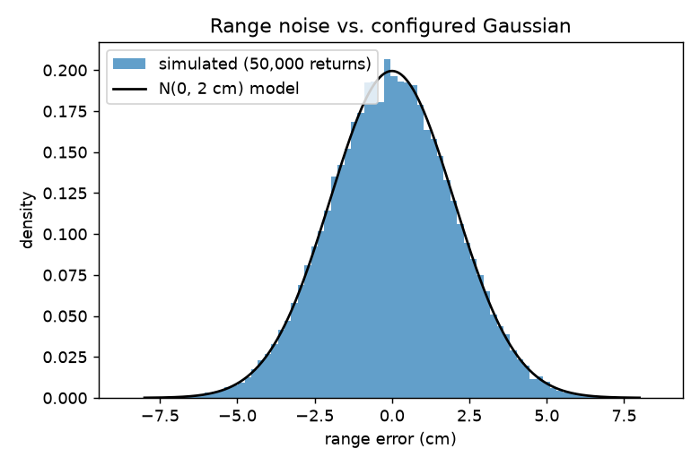
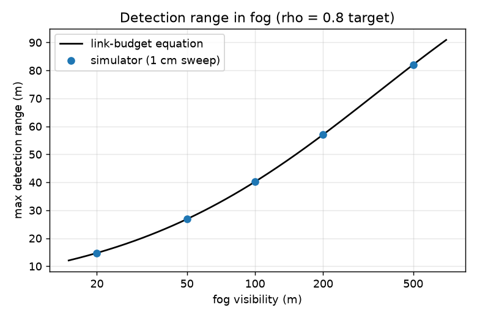
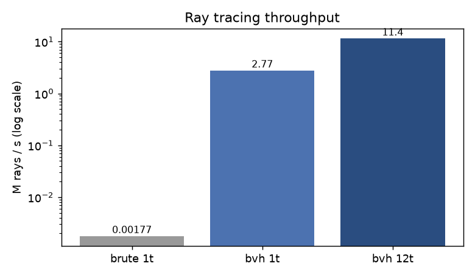
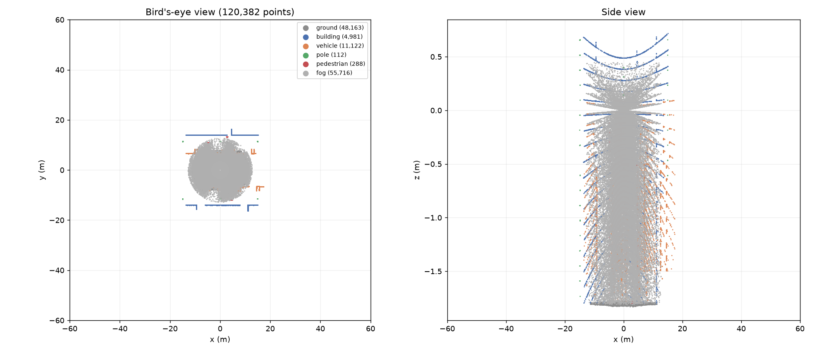

# lidar-sim

A spinning multi-beam **LiDAR sensor simulator** written from scratch in C++17: its own BVH ray tracer,
a physically motivated return model, motion distortion, and a fog model. It outputs labelled point clouds
in the KITTI format, and every part of the model is checked against analytic ground truth.



## What it models

| Piece | Model |
|---|---|
| Firing pattern | C channels at fixed elevations × A azimuths per revolution at f Hz; firing *j* happens at t = j / (A·f). Presets: 64-beam (−24.9° to +2°, 2048 azimuths) and 16-beam (±15°, 1800 azimuths). |
| Geometry | Triangle scenes; nearest hit via a **BVH built with a binned surface-area heuristic** (12 bins per axis), traversed iteratively near-child-first. Möller–Trumbore ray/triangle test with a tiny edge tolerance so shared edges are watertight. |
| Return model | Received power P = ρ · cos θ · e<sup>−2αr</sup> / r² (Lambertian target, incidence angle θ, fog extinction α). A return is detected when P ≥ P<sub>min</sub>. Intensity = ρ · cos θ · e<sup>−2αr</sup>. |
| Noise | Gaussian range noise (σ, default 2 cm) and optional random dropout. |
| Ego motion | Constant velocity + yaw rate during the sweep. Each column fires from the pose at its own time, so a moving sensor shows the same rolling-shutter skew as real raw scans. Points are reported in the sensor frame at firing time. |
| Fog | Beer–Lambert attenuation e<sup>−2αr</sup>, with α = ln(20)/V from visibility V (Koschmieder). Backscatter: the free path before scattering is exponential with rate α, so a beam scatters before range R with probability 1 − e<sup>−αR</sup>, producing a spurious near-range "fog" return (first-return sensor). |
| Ground truth | Every point carries its true range, object id and semantic label (ground, building, vehicle, pole, pedestrian, fog). |
| Determinism | Each beam draws from its own counter-based RNG seeded by (seed, frame, channel, azimuth), so a scan is **bit-identical for any thread count**. |

## Build and run

Requires CMake ≥ 3.16 and a C++17 compiler (developed with GCC 16 / MinGW-w64 on Windows; plain CMake on Linux/macOS).

```bash
cmake -S . -B build -DCMAKE_BUILD_TYPE=Release
cmake --build build -j
./build/lidarsim_tests                       # validation suite; writes validation/metrics.txt
./build/lidarsim_bench --threads 12          # performance
./build/lidarsim_cli --frames 3 --speed 10 --fog 80 --out out   # writes out/frame_*.{bin,csv,ply}
python tools/visualize.py out/frame_000000.csv --out frame.png
python tools/plot_validation.py              # figures in docs/
```

`lidarsim_cli` options: `--scene street|room`, `--preset hdl64|vlp16`, `--azimuth N`, `--frames K`,
`--fog VISIBILITY_M`, `--speed MPS`, `--yaw-rate RADPS`, `--seed S`, `--threads T`, `--no-noise`, `--out DIR`.

## Code map

```
include/lidarsim/  math.hpp      vectors, planar poses
                   geometry.hpp  rays, boxes, ray/triangle and slab tests
                   mesh.hpp      primitives (box, gridded plane, cylinder, sphere) + OBJ loader
                   bvh.hpp       SAH BVH build and traversal, brute-force reference
                   scene.hpp     objects -> world triangles, procedural street and room scenes
                   rng.hpp       counter-based splitmix64 RNG
                   weather.hpp   fog equations
                   lidar.hpp     sensor config, firing model, multithreaded scan
                   io.hpp        KITTI .bin, CSV, PLY
apps/              cli.cpp, bench.cpp
tests/             self-contained test harness + validation suite
tools/             visualize.py, plot_validation.py
```

## Validation

Correctness is checked against closed-form answers and independent reference implementations, not by eye.
Results below come from `lidarsim_tests` (all numbers are written to `validation/metrics.txt`).

**17/17 tests passing (278,677 checks).**

| What is checked | Against | Result |
|---|---|---|
| Room scan, noise off (sensor inside a 20 × 14 × 4 m box, 64 × 2048 beams) | ray–box distance computed independently of the triangle code | 131,072/131,072 returns; max range error **8.9e-15 m** |
| Flat ground | range = h / sin(−el), intensity = ρ·sin(−el) | 120,832 returns; max range error 2.8e-14 m, max intensity error 6.1e-9 |
| Moving sensor (8 m/s + 0.6 rad/s yaw) | analytic ray–box distance from each firing's own pose | max error 1.8e-14 m; scan shifts up to 1.33 m vs. a static scan, so the motion is really modelled |
| BVH | brute force over every triangle; 10 scenes (8 random triangle soups + 2 streets, 60,708 triangles), 100,000 randomized rays, half aimed at random triangles | 62,544 hits; **0** hit/miss, distance or triangle mismatches; 29 rays that hit two triangles at the same distance, each verified as a genuine tie |
| Range noise | configured σ = 0.020 m | n = 262,144: mean −3.4e-5 m, measured σ = 0.0199987 m (0.006% off) |
| Dropout | configured 10% | measured 10.1% (within 4 standard errors) |
| Fog: detection range | link-budget equation solved by bisection, visibilities 20, 50, 100, 200, 500 m and clear air | max discrepancy **0.0085 m (0.02%)**, bounded by the 1 cm sweep step |
| Fog: backscatter probability | e<sup>−α·r_min</sup> − e<sup>−α·R</sup> | 200,000 trials each: V = 50 m expected 0.6688, observed 0.6673 (−0.15 pp); V = 200 m expected 0.2514, observed 0.2507 (−0.07 pp) |
| Determinism | same scan at 1, 2, 3, 4, 8, 12, 16 threads | identical; output files have identical SHA-256 across 1, 2, 4, 8 and 12 threads |
| Labels, KITTI I/O | per-point object labels; write/read round trip | consistent; exact round trip |

 

## Performance

`lidarsim_bench`: the 131,072 rays of one 64-beam scan through the street scene (41,792 triangles; BVH of
26,151 nodes, depth 20), on a laptop Intel Core i5-1235U (10 cores / 12 threads). Each run reports the
median of 7 timed repetitions; the figures below are the median over 6 runs (3 on AC power, 3 on battery),
because laptop clocks vary a lot with temperature.

| Method | Throughput (median, range over runs) | Speedup |
|---|---|---|
| Brute force, 1 thread | 0.0018 M rays/s (0.0011–0.0021) | 1× |
| BVH, 1 thread | 2.77 M rays/s (1.47–3.05) | ~1,350× (median of per-run ratios) |
| BVH, 12 threads | 11.4 M rays/s (6.2–13.7) | ~6,200× total; ~4.2× from threads |

A complete 64-beam scan (131,072 rays, ray tracing + sensor model + output) takes **25 ms with 12 threads**
(median; best run 13.5 ms, about 74 scans/s). Fog adds no measurable cost. Brute force always runs last,
when the chip is hottest, so its speed (and therefore the speedup) varies most between runs.





## Profiling note: why the ground is split into 2 m cells

The first street scene used a 200 m ground plane made of two triangles. Instrumenting the BVH traversal
(nodes visited and triangle tests per ray) showed each ray testing about **191 triangles**, because those
two giant triangles have bounding boxes covering the whole scene, which drags huge boxes deep into the
tree. Splitting the ground into 2 m cells dropped that to **3.9 triangle tests per ray** (an exact count,
49× less work) and made single-thread tracing roughly **4× faster** (3.6–6.8× across six timed runs),
despite the scene having twice as many triangles.

Splitting the ground also exposed a subtle bug: beams running exactly along a grid line could slip
through the crack between two triangles (Möller–Trumbore isn't watertight under rounding), which changed
the scan checksum. A 1e-10 barycentric edge tolerance restored the exact checksum of the unsplit ground.
